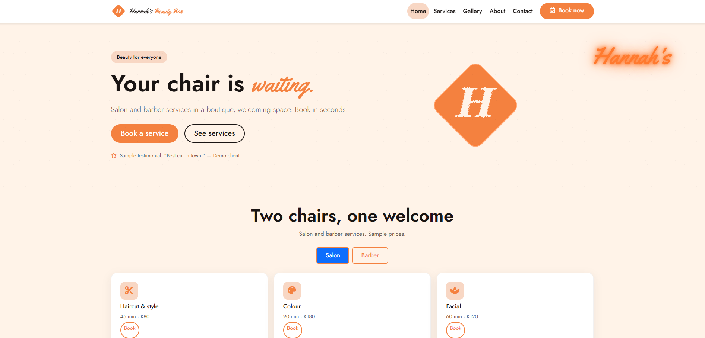
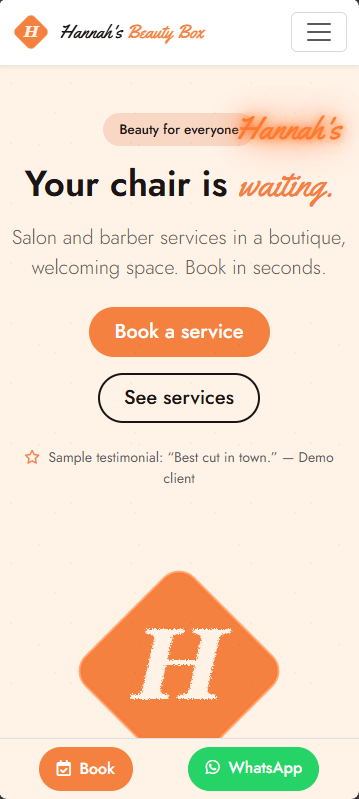

# Hannah's Beauty Box — Design Concept

A stylish, gender-neutral beauty site with a glowing neon personality and booking that takes under a minute.

**Status:** Design concept — not the official website. Built by **Tesseract Cloud Technologies, Port Moresby**. Live demo: `https://tesseract-cloud-technologies.github.io/hannahs-beauty-box/`.





---

## 1. Project overview

Hannah's Beauty Box is a beauty business in a modern retail unit with an arched glass facade and an orange neon script sign. Its logo is an orange diamond tile carrying a dry-brush H. The owner's earlier notes describe a salon plus barber shop, which is unverified and listed in Content to confirm below.

The site serves first-time visitors browsing services, regular clients rebooking quickly, and men looking for a barber appointment. The concept exists to reflect the storefront's neon-and-arch look online, keep booking under a minute, and avoid stereotypes in imagery — and to give the owner a reviewable blueprint before any production build.

Everything on this site is **sample content** unless explicitly marked otherwise. No statistics, awards, testimonials, staff names, prices, or hours have been invented beyond what was supplied in the brief.

---

## 2. Objectives and goals

**Business goals**
- Increase bookings.
- Present a clear service menu.
- Build a boutique brand feel that suits everyone.

**Design goals**
- Reflect the storefront's neon-and-arch look online.
- Keep booking under a minute.
- Avoid stereotypes in imagery and language.

**Suggested success measures for a live version**
- Home page to booking confirmation rate.
- Booking form completion time.
- Salon vs barber tab selection split (once barber service is confirmed).
- Regular-client rebooking rate.
- Gallery page engagement.

These are suggested measures, not supplied data.

---

## 3. Users and user goals

| Persona | Situation | Goal | How the interface helps |
|---|---|---|---|
| First-time visitor | Browsing services before committing | Understand what is offered and roughly what it costs | Salon and Barber tabs on the home page and services page with sample durations and prices |
| Regular client | Knows what they want; short on time | Rebook quickly | Sticky Book button in the navbar and on the mobile bottom bar; booking form pre-selects from the services page |
| Man looking for a barber appointment | Unsure if the business serves men | Find a barber service quickly | Barber tab visible in the same prominent position as the salon tab |

**Top three user tasks and target taps/clicks**
1. From home page to booking confirmation — **4 taps** (Book → select service → date and time → confirm).
2. From services page to a pre-filled booking form — **1 tap** ("Book this" on a service card).
3. From home page to the gallery — **1 tap** (Gallery).

---

## 4. Brand and visual identity

Brand cues came from the brief: a modern retail unit with an arched glass facade, an orange neon script sign, and a diamond tile logo with a dry-brush H. The visual language leans on warm cream and blush for softness, espresso for depth, and Sunset Orange and Neon Glow for the sign's energy.

**Colour palette**

| Swatch | Name | Hex | Role | Contrast note |
|---|---|---|---|---|
|  | Sunset Orange | #F4813F | Logo tile, primary buttons, accents | Use with Espresso text for AA |
|  | Neon Glow | #FF7A2F | Neon sign, glow effects | Decorative; not used for body text |
|  | Espresso | #1A1514 | Storefront frames, dark mode base, body text | AA against Warm Cream and Blush |
|  | Warm Cream | #FFF3E8 | Page base | AA with Espresso text |
|  | Blush | #F8D7C4 | Alternate sections, badges | AA with Espresso text |
|  | White | #FFFFFF | Cards, form fields | AA with Espresso text |

**Typography**

| Font | Weights | Where used | Why |
|---|---|---|---|
| Yellowtail | 400 | Logo script accent, section accents, the neon sign | Matches the rounded script of the storefront signage |
| Jost | 300, 400, 500, 600, 700 | UI, body, navigation, buttons | Neutral geometric sans that keeps the site gender-neutral and readable |

**Signature shapes and motifs**
- A rotated-square diamond tile carrying a dry-brush H, drawn as inline SVG with a subtle turbulence filter.
- Arch-topped image frames (`border-radius: 999px 999px 0 0`) echoing the arched glass storefront.
- Thin black mullion grid lines like the glass doors, used sparingly as background details.
- A speckled dot texture on the hero at very low opacity.
- Neon outline strokes with glow on the hero sign and the heart motif.

**Imagery and icons**
No stock photography is used, and no people are depicted, keeping the look gender-neutral. Image slots are clearly marked with gradient and arch fallbacks. Font Awesome Free 6.5.2 provides icons: scissors, palette, spa, brush, hot-tub, heart, star.

**Tone of voice**
Warm and inviting without gendering anyone. "Your chair is waiting." rather than "Pamper yourself, ladies." Sample content is labelled as sample wherever it appears.

---

## 5. UI design system

**Grid and spacing**
Bootstrap 5.3.3 twelve-column grid. Section rhythm uses `py-5` with `clamp()` on display type. Cards share a 16px radius and a single soft shadow token.

**Breakpoints**
Mobile-first, tested at 320, 360, 390, 768, 1024, 1440 and 1920px. Tabs scroll inside their own container on phones. The arch gallery becomes a two-column grid on phones. The sticky bottom bar appears only on phones.

**Key components and states**

| Component | States |
|---|---|
| Primary button (`btn-orange`) | Default, hover (lift + orange glow), focus-visible, active, disabled |
| Outline button | Default, hover, focus-visible |
| Salon / Barber tab pills | Default, active, hover |
| Service card | Default, hover (lift + soft glow) |
| Service checkbox (booking form) | Unchecked, checked, focused |
| Time chip | Default, hover, selected |
| Neon lamp switch | On, off |
| Dark mode | Light, dark |
| Form input | Default, focus (orange ring), invalid, valid |
| Summary card | Empty, populated |

**Animations and reduced-motion fallbacks**

| Animation | Purpose | Reduced-motion fallback |
|---|---|---|
| Neon flicker-on (hero sign) | Mimics a real neon sign switching on | Disabled — sign shown at full opacity |
| Diamond pop-in (rotate + scale) | Draws the eye to the logo | Disabled — diamond static |
| Arch reveal upward (clip-path) | Matches the storefront's arches | Disabled — arches visible |
| Sliding tab panels with fade | Signals a clean switch between Salon and Barber | Disabled — instant switch |
| Soft orange glow on hover | Confirms interactivity | Transition duration reduced |
| Neon lamp toggle | Flips the sign and page between light and dark | Instant toggle; no animation |

All motion is disabled under `prefers-reduced-motion: reduce`.

**Accessibility decisions**
- Skip link on every page.
- One `<h1>` per page.
- Visible `:focus-visible` ring in Sunset Orange.
- ARIA labels on all icon buttons, including the neon lamp switch.
- The lamp switch is a proper toggle with `aria-pressed`.
- Booking form is front-end only and clearly states "This is a demo, no real booking has been made."
- Minimum 44px tap targets.
- AA contrast for body text; Neon Glow not used for body copy.
- Dark mode keeps the same contrast pairs, swapping Warm Cream and Espresso.

---

## 6. Page map and user flows

**Sitemap**

```mermaid
flowchart TD
    Home[index.html] --> Services[services.html]
    Home --> Gallery[gallery.html]
    Home --> Book[book.html]
    Home --> About[about.html]
    Home --> Contact[contact.html]
    Services --> Book
    Gallery --> Book
    Book --> Summary[Booking summary and success]